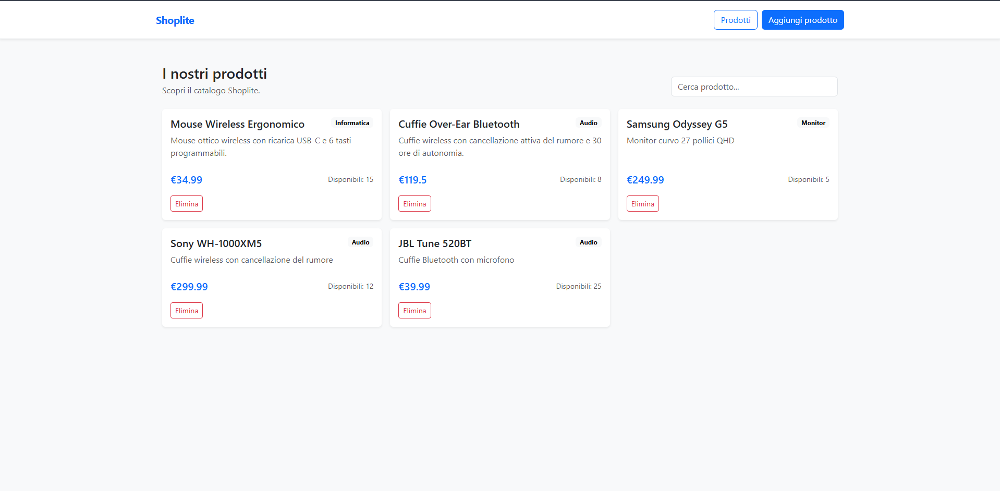
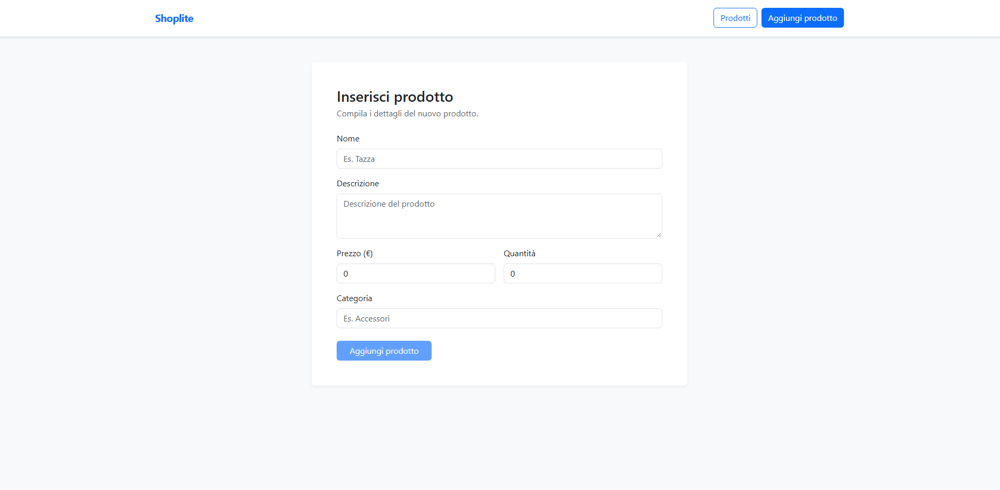

# ShopLite

ShopLite is a full-stack web application for managing an e-commerce product catalog, built with **Spring Boot** and **Angular**.

The project demonstrates REST API development, database integration, frontend-backend communication and reactive programming.

## Features

- Product catalog visualization
- Product creation, editing and deletion
- Product search with debouncing
- Category-based filtering
- Reactive forms
- RESTful API integration

## Screenshots

### Product Catalog (Homepage)



### Create Product



## Tech Stack

| Backend | Frontend |
|---------|----------|
| Java | Angular |
| Spring Boot | TypeScript |
| Spring Data JPA | RxJS |
| Hibernate | Angular Signals |
| MySQL | HTML & CSS |
| Maven | |

## Architecture

The backend follows a layered architecture with separation of responsibilities:

- **Controller** — REST API endpoints
- **Service** — Business logic
- **Repository** — Database access
- **DTO** — Data transfer objects
- **Mapper** — Object conversion
- **Entity** — Database entity representation

The frontend uses a component-based architecture with dedicated services and models.

## Project Structure

```text
ShopLite/
├── backend/
├── frontend/
├── screenshots/
│   ├── homeAndSearchBar.png
│   └── addProduct.png
├── .gitignore
└── README.md
```

## Getting Started

### 1. Database Setup

Create a MySQL database:

```sql
CREATE DATABASE shoplite;
```

### 2. Backend

Configure your database credentials through environment variables:

```bash
export DB_USERNAME=root
export DB_PASSWORD=your_password
```

Start the Spring Boot application:

```bash
cd backend
./mvnw spring-boot:run
```

The backend runs at `http://localhost:8080`.

### 3. Frontend

From the root directory, open a new terminal and run:

```bash
cd frontend
npm install
npm start
```

Open `http://localhost:4200` in your browser.

## Project Purpose

ShopLite was developed as a learning and portfolio project to consolidate practical skills in full-stack web development using Java, Spring Boot and Angular.